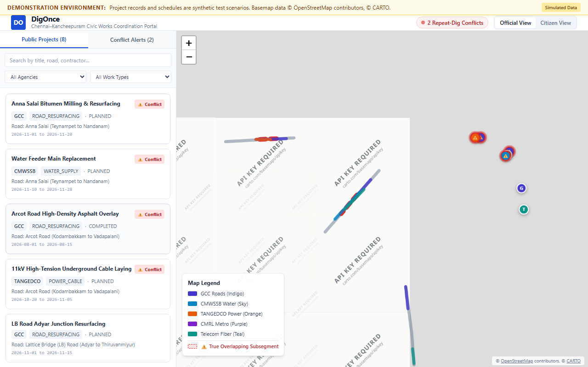

# DigOnce (சென்னை–காஞ்சிபுரம்) — Civic Works Coordination Portal

> **Civic Infrastructure Coordination & Repeat-Dig Conflict Detection Platform for Chennai–Kancheepuram, Tamil Nadu, India.**

---

## 1. Problem Statement & Objective
In urban Indian municipalities, road surfaces are repeatedly excavated by siloed public infrastructure agencies (Greater Chennai Corporation [GCC] Roads, Chennai Metro Water [CMWSSB], TANGEDCO Electricity Board, telecom operators, and CMRL Metro Rail). A newly resurfaced road is frequently dug up weeks later for utility trenching, causing immense traffic congestion, damage to existing subterranean utilities, and citizen frustration.

**DigOnce** provides a unified, map-centric coordination portal equipped with a **deterministic Repeat-Dig Conflict Engine** to flag schedule collisions and post-resurfacing coordination risks before physical excavation begins.

---

## 2. Implemented & Verified Capabilities
- **Interactive GIS Map (Chennai–Kancheepuram Corridor):** Vector polylines for municipal road segments and project sites rendered on high-performance CartoDB Positron / OpenStreetMap basemap tiles.
- **Deterministic Repeat-Dig Conflict Engine:**
  - **Rule A (Concurrent Work Collision):** Flags active/planned projects scheduling excavation on overlapping subsegment chainages during overlapping calendar dates.
  - **Rule B (Recent-Resurfacing Coordination Risk):** Flags planned excavations on road subsegments completed within a configurable demonstration heuristic window (180 calendar days post-paving).
- **True Subsegment Polyline Rendering:** Piecewise linear interpolation highlights the exact physical chainage overlap on the map rather than indiscriminately coloring the entire road.
- **Faceted Project Discovery:** Real-time text search (street names, contractors, titles) and filtering by civic agency (`GCC`, `CMWSSB`, `TANGEDCO`, `CMRL`, `TELECOM`) and work category (`Resurfacing`, `Water`, `Power`, `Fiber`, `Metro`).
- **Contextual Inspector:** Detail drawer displaying agency allocation, tender specifications, inclusive date boundaries, exact conflict trigger rules, and actionable coordination advisories.
- **Coordination Action Workflow:** Reviewers can mark findings as `REVIEWED` or propose synchronization via `COORDINATION_PROPOSED`, updating the UI instantly and safely persisting in the browser's `localStorage`.
- **Responsive Civic Design System:** Clean, accessible layout built on Tailwind CSS tokens (`civic-navy`, `civic-blue`, `civic-red`, `civic-amber`) with mobile bottom-sheet adaptability.

---

## 3. Technology Stack & Architecture
- **Framework:** Next.js 15.5.27 (App Router, React 19.0.0, Node.js v24 LTS compatible).
- **Language:** TypeScript 5.7.3 (Strict Type Checking).
- **Styling:** Tailwind CSS 3.4.17 with Radix UI design tokens.
- **GIS Engine:** Leaflet 1.9.4 with dynamic client-side SSR isolation.
- **Testing:**
  - **Unit Tests:** Vitest 2.1.9 (23 automated test cases covering date boundaries, order-independence, subsegments, and heuristics).
  - **Browser E2E Tests:** Playwright 1.50.0 (Chromium headless testing verifying discovery, inspection, coordination actions, persistence, and mobile viewports).

---

## 4. Getting Started & Installation

### Prerequisites
- Node.js >= 18.18 (Verified on Node.js v24.15.0 LTS)
- npm >= 10.0 (Verified on npm 11.12.1)

### Setup & Execution
```bash
# Clone the repository
git clone <repository-url>
cd DigOnce

# Install dependencies
npm install

# Run the development server
npm run dev

# Open http://localhost:3000 in your browser
```

---

## 5. Verification Commands

All checks are automated and reproducible locally:

```bash
# 1. Run unit test suite (Vitest)
npm test

# 2. Run browser end-to-end journey (Playwright)
npx playwright test

# 3. Run strict TypeScript compilation check
npm run typecheck

# 4. Run ESLint checks
npm run lint

# 5. Build optimized production bundle
npm run build

# 6. Serve production build locally
npm run start
```

---

## 6. Data Provenance & Demonstration Disclosures
- **Synthetic Project Records:** All 8 public works projects, contractor names, work order numbers, and schedules are **fictional demonstration records** created solely for evaluating the conflict detection algorithm. They do not represent active government tenders or verified contractor activity.
- **Geographic Basemap:** Basemap tiles are powered by OpenStreetMap contributors and CARTO under Open Database License (ODbL). Stored road paths represent real thoroughfares in Chennai (Anna Salai, Arcot Road, LB Road) and Kancheepuram (Gandhi Road).
- **Local Persistence Limitation:** Coordination review actions are stored exclusively in the current browser session (`localStorage`). The prototype does not transmit NOC applications or write-back data to municipal databases.
- **Demonstration Heuristic:** The 180-day post-paving coordination rule is implemented as an operational demonstration heuristic, not a verified statutory mandate.

---

## 7. Open-Source Libraries & Attribution
- [Next.js](https://nextjs.org/) (MIT)
- [React](https://react.dev/) (MIT)
- [Leaflet](https://leafletjs.com/) (BSD 2-Clause)
- [OpenStreetMap](https://www.openstreetmap.org/copyright) (ODbL)
- [CARTO Positron](https://carto.com/attributions) (Free basemap tiles)
- [Tailwind CSS](https://tailwindcss.com/) (MIT)
- [Vitest](https://vitest.dev/) (MIT)
- [Playwright](https://playwright.dev/) (Apache 2.0)

---

## 8. Verified Interface Screenshot


